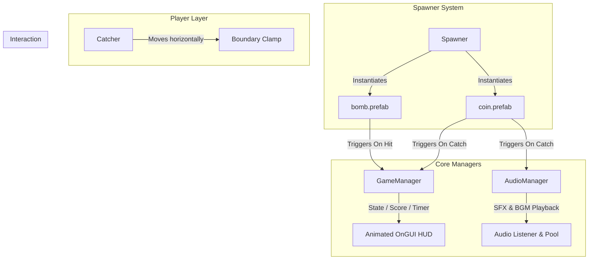

# Coin Catcher 2D

A fast-paced 2D arcade reflex game built with Unity 6 and the Universal Render Pipeline (URP). Players control a dynamic catcher to collect falling golden coins while dodging dangerous bombs within a 60-second challenge window. Features persistent high-score tracking, responsive multi-voice audio, animated UI states, and a performance-based ranking tier.

---

## Technical Specifications

- Engine: Unity 6 (6000.6.7f1)
- Render Pipeline: Universal Render Pipeline (URP 2D - 17.6.0)
- Scripting Backend: C# (.NET Standard 2.1)
- Input System: Unity Input Manager (Legacy & Action Mappings)
- Target Platforms: PC / macOS / Linux / WebGL
- Physics Model: 2D Physics (Trigger Colliders & Kinematic Translation)

---

## Key Features

- Fast Arcade Mechanics: Responsive horizontal movement and falling collectible mechanics.
- Risk vs. Reward Scoring: Earn points for coins, but lose score if bombs make contact with the catcher. Score is strictly clamped to prevent negative values.
- Dynamic Spawner: Configurable spawn rates, random horizontal ranges, and adjustable bomb-to-coin spawn ratios.
- Zero-Latency Audio Architecture: Custom audio engine featuring dynamic in-memory waveform trimming and pre-allocated voice pooling to ensure instantaneous SFX playback without decoder delays.
- Dynamic HUD & Game Over Sequence: Fully animated state transitions, screen shake, pulsating typography, animated score count-up, and real-time rainbow HSV rank displays.
- Persistent High Score System: Automated local persistence via PlayerPrefs across play sessions.
- Clean Component Separation: Decoupled scripts adhering to Single Responsibility and Singleton design patterns.

---

## Gameplay & Controls

### Objective
Catch as many golden coins as possible before the 60-second countdown expires. Avoid falling bombs that deduct your score.

### Controls

| Action | Primary Key | Secondary Input |
|---|---|---|
| Move Left | Left Arrow / A | Horizontal Axis |
| Move Right | Right Arrow / D | Horizontal Axis |
| Start Game | Spacebar | Left Mouse Button |
| Restart Game | R | - |

---

## Scoring & Ranking System

- Coin Collected: +1 Point
- Bomb Hit: -3 Points (Score cannot drop below 0)
- Time Limit: 60 Seconds

At the end of the match, players are evaluated based on their final score:

| Score Threshold | Rank Awarded | Description |
|---|---|---|
| 40+ Points | LEGEND!!! | Master tier performance with animated rainbow styling |
| 25 - 39 Points | PRO | Advanced catcher efficiency |
| 10 - 24 Points | NOT BAD | Solid beginner performance |
| 0 - 9 Points | TRY AGAIN | Needs more practice avoiding hazards |

---

## Architecture & System Design

The project is structured around lightweight, decoupled components for optimal performance and maintainability.



### Script Architecture

1. `GameManager.cs`
   - Core game loop controller (Awake, Start, Running, GameOver).
   - Manages match timer (`timeLeft`), current score, and high score persistence via `PlayerPrefs`.
   - Handles GUI rendering, screen shake matrix transformations, and score tally animations.

2. `AudioManager.cs`
   - Centralized audio manager managing background music and sound effects.
   - Implements `PrepareCoinAudio()`: an in-memory waveform scanner that automatically detects and strips leading silence from audio clips on `Awake()`, eliminating playback latency.
   - Multi-source pool (8 pre-allocated `AudioSource` instances) running `PlayOneShot` to allow rapid, overlapping coin chimes without clipping or stutter.

3. `catcher.cs`
   - Player movement script using smooth horizontal axis translation.
   - Enforces configurable boundary limits (`Mathf.Clamp`) to keep the player within the camera view.

4. `spawner.cs`
   - Procedural item generator spawning prefabs at randomized X coordinates along the top screen edge.
   - Configurable spawn frequency (`spawnInterval`) and hazard probability (`bombChance`).

5. `coinDrop.cs`
   - Translates coin prefabs downward at a constant velocity.
   - Detects trigger collisions with the catcher, increments score, plays audio, and destroys itself.
   - Automatically cleans up objects falling below the lower screen threshold (`y < -6f`).

6. `bomb.cs`
   - Translates bomb hazards downward.
   - Detects collisions with the catcher, deducts score penalty, and handles cleanup.

---

## Audio Engine Optimization

Sound latency is a common issue in arcade games when using compressed audio files with introductory silence or decoder seek latency. This project implements a custom low-latency solution in `AudioManager.cs`:

- Automated Silence Trimming: On startup, raw audio samples are inspected using `AudioClip.GetData()`. The engine locates the exact sample where amplitude crosses the threshold (`0.02f`) and constructs a clean in-memory PCM `AudioClip`.
- Zero-Seek Triggering: Sounds play instantly from sample 0 using `AudioSource.PlayOneShot()`, removing the need for runtime seek operations (`AudioSource.time`).
- Pre-allocated Channel Pool: 8 independent audio source channels prevent audio cutoffs during high-density coin collection streaks.

---

## Project Structure

```
ISD ONLINE WORKSHOP/
├── Assets/
│   ├── Audio/
│   │   ├── bgmusic.mp3               # Looping arcade electronic soundtrack
│   │   └── Coin Collect SFX.mp3      # High-fidelity coin collection chime
│   ├── Prefabs/
│   │   ├── Spawner.prefab            # Configured procedural item spawner
│   │   ├── coin.prefab               # Coin prefab with collider and coinDrop script
│   │   └── bomb.prefab               # Bomb hazard prefab with collider and penalty script
│   ├── Scenes/
│   │   ├── isd workshop.unity        # Main production game scene
│   │   └── isd online.unity          # Workshop iteration scene
│   ├── Scripts/
│   │   ├── AudioManager.cs           # Audio manager and low-latency audio engine
│   │   ├── GameManager.cs            # Game state, HUD, timer, and high score manager
│   │   ├── bomb.cs                   # Bomb translation and hazard trigger
│   │   ├── catcher.cs                # Player horizontal controller
│   │   ├── coinDrop.cs               # Coin translation and collection trigger
│   │   └── spawner.cs                # Randomized item and hazard spawner
│   ├── Settings/                     # URP 2D renderer assets and input settings
│   └── Sprites/                      # 2D visuals (Neon background, coins, bombs, bowl)
├── Packages/                         # Unity package manifests (URP, 2D suite, Input System)
├── ProjectSettings/                  # Project configuration, tags, physics, and build settings
└── README.md                         # Project documentation
```

---

## Inspector Configuration Parameters

The components are exposed with developer-friendly parameters for easy balance tuning:

### GameManager (`GameManager.cs`)
| Parameter | Default | Description |
|---|---|---|
| `timeLimit` | 60f | Duration of a game round in seconds |

### Spawner (`spawner.cs`)
| Parameter | Default | Description |
|---|---|---|
| `coinPrefab` | coin | Prefab reference for falling coin collectible |
| `bombPrefab` | bomb | Prefab reference for falling hazard |
| `spawnInterval` | 0.8f | Time in seconds between item spawns |
| `xRange` | 8.0f | Horizontal span (-xRange to +xRange) for item drops |
| `spawnY` | 6.0f | Vertical spawn height |
| `bombChance` | 0.25f | Probability (0.0 to 1.0) of spawning a bomb instead of a coin |

### Player Catcher (`catcher.cs`)
| Parameter | Default | Description |
|---|---|---|
| `speed` | 10.0f | Horizontal movement speed |
| `limit` | 8.0f | Maximum absolute X position (left/right screen boundaries) |

### Hazard (`bomb.cs`)
| Parameter | Default | Description |
|---|---|---|
| `fallSpeed` | 4.0f | Downward movement speed |
| `scorePenalty` | 3 | Points deducted upon contact |

### Collectible (`coinDrop.cs`)
| Parameter | Default | Description |
|---|---|---|
| `fallSpeed` | 4.0f | Downward movement speed |

### Audio Manager (`AudioManager.cs`)
| Parameter | Default | Description |
|---|---|---|
| `bgMusic` | bgmusic | Background music clip |
| `coinSound` | Coin Collect SFX | Coin collection sound effect clip |
| `musicStartTime` | 16.0f | Start/loop timestamp in seconds for background track drop |
| `musicVolume` | 0.5f | Volume level for background music (0.0 to 1.0) |
| `coinVolume` | 1.0f | Volume level for coin SFX (0.0 to 1.0) |

---

## Installation & Setup

1. Prerequisites:
   - Unity Hub installed.
   - Unity 6 Editor (version `6000.6.7f1` or compatible).

2. Clone Repository:
   ```bash
   git clone https://github.com/codebrak07/ISD-ONLINE-WORKSHOP.git
   ```

3. Open in Unity:
   - Launch Unity Hub.
   - Click "Add" and select the cloned `ISD ONLINE WORKSHOP` directory.
   - Open the project with Unity 6.

4. Run the Game:
   - Navigate to `Assets/Scenes/` in the Project window.
   - Open `isd workshop.unity`.
   - Press the Play button in the Unity Editor toolbar.
   - Press Spacebar or click to begin.

---

## Build Instructions

### Standalone (Windows / macOS / Linux)
1. Open File > Build Profiles (or Build Settings).
2. Ensure `Assets/Scenes/isd workshop.unity` is included in the Scenes In Build list.
3. Select your target platform (macOS, Windows, or Linux).
4. Click Build or Build and Run.

### WebGL
1. In Build Profiles, switch target platform to WebGL.
2. In Project Settings > Player > Resolution and Presentation, configure resolution settings (recommended: 1920x1080 or responsive canvas).
3. Click Build and export to an output directory.

---

## License

This project is developed for educational and workshop purposes under the ISD Online Workshop curriculum. Assets and code are free to use and modify for learning, prototyping, and portfolio demonstrations.
